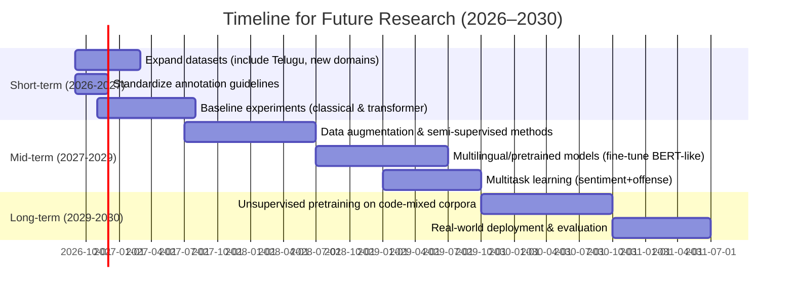

# Code-Mixed Sentiment Analysis in Dravidian Languages (2020–2026): Literature Review

**Executive Summary:** Recent years have seen growing interest in sentiment analysis of Dravidian languages (Tamil, Telugu, Kannada, Malayalam, etc.) in social media, where code-mixing (e.g. Tamil–English) is common. A number of annotated corpora and shared tasks have emerged (e.g. FIRE Dravidian-CodeMix), and researchers have applied varied methods from classical ML to Transformers. Nonetheless, challenges remain due to limited data, severe class imbalance, and linguistic complexity. This report surveys the key datasets and methods (2020–2026), summarizes toolkits and evaluation practices, and highlights research gaps and recommended future work. Two tables compare datasets (with size, languages, annotation, availability) and modeling approaches (architecture, data, metrics, results). We also outline recommended workflows (using Mermaid diagrams) and timelines for advancing this field.

## Datasets

Key sentiment-analysis datasets for Dravidian code-mixed text have been released primarily through research groups in India and Europe. Most corpora are collected from YouTube comments, contain Roman-script code-mixing, and annotate sentiment (often 3–5 classes) and sometimes offensive labels. Table 1 summarizes the major datasets (2020–2022):

| **Dataset (Ref.)**    | **Size**         | **Language Pair(s)** | **Code-Mix Type**            | **Labels**                                      | **Availability / License**       |
|-----------------------|------------------|----------------------|------------------------------|---------------------------------|------------------------------|
| *TamilMixSentiment* | 15,744 comments | Tamil–English       | Tanglish (Roman script) including inter-/intra-sentential mixing | Sentiment: **Positive, Negative, Mixed feelings, Neutral, Other** | GitHub/Zenodo (CC-BY-NC) |
| *MalayalamMixSentiment* | 6,739 comments  | Malayalam–English   | Romanized Malayalam–English mixing | Sentiment: **Positive, Negative, Mixed, Neutral, Other (non-Malayalam)** | GitHub (CC-BY-NC) |
| *TeluguMixSentiment* | 19,857 sentences | Telugu–English      | Code-switched text (Roman/Unicode) | Sentiment: **Positive, Negative, Neutral** (with word-level lang-tags) | GitHub (open) |
| *KanCMD* (Kannada) | 7,671 comments   | Kannada–English     | YouTube comments (Roman)      | Multi-task: **Sentiment (Pos/Neg/Neu/Other)** + **Offensive (targeted/untargeted/etc.)** | ACL Anthology (PEOPLES 2020) PDF; dataset link (unknown license) |
| *DravidianCodeMix* | ~60,000 comments<BR>(44k Tamil, 20k Malayalam, 7k Kannada) | Tamil–English,<br>Malayalam–English,<br>Kannada–English | All code-mixing phenomena (Roman script) | Sentiment: **Positive, Negative, Mixed, Neutral, Other**; Offensive: multi-class (offensive/targeted/group/other) | GitHub/Zenodo (CC-BY) |

**Table 1:** *Code-mixed Dravidian sentiment corpora (2020–2022). Sizes and label schemes as reported in the cited sources. “Other” usually denotes sentences in a foreign language. All datasets are manually annotated, with high inter-annotator agreement (Krippendorff’s α ~0.6–0.9).*

For example, Chakravarthi et al. (2020) describe *TamilMixSentiment*: a YouTube comment corpus of 15,744 Tanglish sentences, annotated by 11 Tamil speakers with five sentiment classes. 67% of that data was positive, making classes highly imbalanced. The *MalayalamMixSentiment* corpus (6,739 comments) has a similarly skewed distribution (2,811 positive, 1,903 neutral, 884 “other language”).  Kusampudi et al. (2021) released 19,857 Telugu–English sentences labeled for sentiment (3 classes) and word-level language tags.  Hande et al. (2020) introduced *KanCMD* (7,671 comments) for Kannada with sentiment and offensive labels.  Chakravarthi et al. (2022) present *DravidianCodeMix*, a large multilingual dataset (~44k Tamil, 20k Malayalam, 7k Kannada) with sentiment and offense annotations.

All datasets are publicly available (GitHub or venue pages) for research use. Most use liberal CC-BY(-NC) licenses. Code-mixed text is unstructured and noisy; these corpora include romanized native words and mixed English terms, covering *inter*-sentential, *intra*-sentential, and even *intra-word* code-switching. 

## Methods and Results

Researchers have applied a broad range of techniques, from classical classifiers on surface features to deep neural and transformer models. The choice often depends on data availability and compute resources. Table 2 compares representative approaches:

| **Method / Model**                  | **Language(s)**         | **Features / Architecture**                             | **Training**                                    | **Performance (Metric)**                        | **Source** |
|-------------------------------------|-------------------------|--------------------------------------------------------|-------------------------------------------------|------------------------------------------------|-------------|
| **Traditional ML (SVM, LR, NB, DT, KNN)** | Tamil–English (Tanglish) | TF-IDF (n-grams); basic classifiers; ensemble of SVM, RF, KNN (MUCS) | 90/5/5 train-dev-test split on 15k+ data | Tamil: Macro F1 ≈ **0.26** (best ensemble); Acc up to 99% (but trivial due to class imbalance) | Shanmugavadivel et al. (2024); shared task results |
| **Unsupervised Norm + MLP**         | Telugu–English          | Data normalization (syllable+word embeddings); MLP classifier | Full dataset training (no held-out reported)      | Accuracy **80.22%** (3-class sentiment) | Kusampudi et al. (2021) |
| **CNN + BiLSTM (hybrid DL)**        | Tamil–English          | Convolutional layers + Bi-LSTM layers on text embeddings | Trained on TamilMixSentiment (15k)             | Reported as *effective* in experiments (no explicit metric given) | Shanmugavadivel et al. (2024) |
| **Transfer Learning (Transformers)**| Tamil–English,<br>Kannada–English | Pretrained mBERT / XLM-R / IndicBERT, fine-tuned on dataset | Fine-tune on training split, eval on test       | Tamil: Macro F1 **0.227** (IndicBERT); other runs similar | Eusha et al. (2024); others (various teams) |
| **Data Augmentation / Back-translation** | All (proposed) | Synthetic code-mix generation, translation, paraphrasing | (Future work: not widely evaluated yet)       | – (suggested for future improvement)             | – (discussed in literature) |
| **Transliteration / Subword**       | All (proposed)  | Roman ↔ native script mapping; subword tokenization     | (Baseline: often no transliteration applied)    | – (expected to improve model training)          | – (recommendation) |

**Table 2:** *Comparison of modeling approaches. Performance highlights are macro F1 or accuracy as reported in cited studies. “Traditional ML” refers to standard classifiers (SVM, logistic regression, etc.) on TF-IDF or similar features. Many teams (e.g. MUCS) found an ensemble of SVM+RandomForest+KNN achieved the best macro F1 (≈0.26 on Tamil).  Deep models like CNN+BiLSTM have shown promise, while fine-tuned Transformers (IndicBERT, XLM-R, etc.) are increasingly used. Kusampudi et al. show that unsupervised normalization boosts an MLP to ~80.2% accuracy on Telugu–English.*

Several trends emerge: classical models on raw n-grams can be quite strong on imbalanced data (e.g. >99% accuracy for majority-class Tamil), but this overstates performance (macro F1 was only ~0.26). Incorporating linguistic features or ensembling often helps F1. Deep models (CNN, LSTM) can capture context, and hybrid CNN+BiLSTM was found effective for Tamil. However, due to limited data, overfitting is a risk. 

Recently, pretrained multilingual Transformers have become popular: Eusha et al. (2024) fine-tuned IndicBERT and mBERT for Tamil and achieved a macro F1 of 0.227 (rank 3 in a shared task). Some teams ensemble Transformers with classical models to boost robustness. Subword approaches (Byte-Pair Encoding or WordPiece) and transliteration (mapping romanized words to native script) are less explored but recommended, given the mismatch between Roman social-media text and models trained on native-script data. 

Typical evaluation uses **macro-averaged F1** (balanced over classes) due to skew. Other metrics (accuracy, weighted F1) are also reported. Shared tasks (e.g. FIRE Dravidian-CodeMix) observed best weighted F1 of ~0.71 (Tamil), 0.80 (Malayalam), 0.63 (Kannada), highlighting that code-mixed Tamil is still very challenging. 

```mermaid
flowchart LR
    A[Data Collection: YouTube comments] --> B[Preprocessing: tokenization, normalization]
    B --> C[Feature Extraction or Embedding]
    C --> D[Model Training (ML/DL/Transformer)]
    D --> E[Evaluation (macro-F1, etc.)]
    E --> F[Deployment / Feedback Loop]
```

## Tools & Resources

Researchers typically use standard NLP libraries and platforms. Common toolkits include Python with **scikit-learn** for classical models and **PyTorch/TensorFlow** (with Keras) for neural networks. Pretrained models from the **Hugging Face Transformers** library (e.g. `IndicBERT`, `bert-base-multilingual-cased`, `xlm-roberta-base`) are popular for transfer learning. Data preprocessing may use the **Polyglot** or **fastText** language identifiers to detect script/language, and tools like **Indic NLP** for tokenization/transliteration. Resource-wise, most corpora above provide raw and tokenized text, sometimes with code for baseline experiments. There are also lexicons and stopword lists for Tamil and other Dravidian languages, but their use is limited in modern neural pipelines. Overall, the workflows combine open-source ML libraries with language-specific preprocessing scripts and often custom annotation interfaces.

## Evaluation & Reproducibility

Current practice is to split each corpus into train/dev/test (often 80–90% train, 10–20% dev/test). For example, Chakravarthi et al. used a **90/5/5** stratified split on DravidianCodeMix data. Cross-validation is uncommon due to dataset size. Models are tuned on the development set, then reported on held-out test. Metrics are averaged per class (macro F1) to mitigate imbalance. Many studies report both macro and weighted F1, accuracy, precision/recall (Tables 2 & 3 in ). 

**Reproducibility:** Most datasets and baseline code have been released (GitHub, Zenodo) with open licenses. However, variations in annotation guidelines (e.g. what counts as “mixed” vs “neutral”) can hamper direct comparison. Also, some studies use volunteer annotators, which may lead to domain-specific biases. Shared tasks (FIRE, DravidianLangTech) help by providing common test sets and evaluation scripts. In future work, ensuring fixed random seeds and providing trained model checkpoints (in addition to code) would improve replicability. For now, we note that reported results should be interpreted in context of dataset and split; citing standard baselines (e.g. those in Table 2) is recommended for new work.

## Research Gaps & Future Directions

Despite progress, **significant gaps** remain. Key observations and recommendations:

- **Expand Language Coverage:** Existing corpora cover Tamil, Malayalam, Kannada, and Telugu. Other Dravidian languages (Tulu, Kodava, etc.) lack data. Extending to more dialects and mixing with Hindi or other Dravidian languages would be valuable. Likewise, datasets should include contemporary domains (e.g. social media beyond YouTube, forums, reviews).

- **Balance & Annotation Quality:** All current corpora have severe class imbalance (e.g. 67% positive in Tamil). New datasets should aim for more balanced class representation. Multi-label sentiment or fine-grained emotions (joy, anger, etc.) and normative guidelines for “neutral” vs “other” categories would improve consistency. Involving native speakers and clear guidelines can raise inter-annotator agreement.

- **Advanced Modeling:** Methods so far mainly use standard models. **Short-term:** We recommend systematically benchmarking multilingual pretrained models (e.g. mBERT, XLM-Roberta) on each language pair, and exploring domain adaptation (fine-tuning on code-mixed text). **Mid-term:** Research should examine self-supervised or unsupervised pretraining on large unlabeled code-mixed corpora (e.g. train a new BERT on YouTube comments). Data augmentation (back-translation, synonym replacement) and semi-supervised learning (label propagation) are promising for low-resource settings. Multitask learning (sentiment + offensiveness) could leverage the KanCMD framework. 

- **Evaluation Improvements:** Future evaluations should report per-class F1 (as in shared tasks) and include error analysis (which code-switch types cause errors). Standardizing test sets (e.g. through annual shared tasks) will help track progress. Also, user-centric evaluation (e.g. human-in-the-loop studies) could assess real-world utility. 

- **Practical Deployment:** For deployment (e.g. social media monitoring, digital assistants), handling OOV (out-of-vocabulary) words and real-time code-mixed streams is crucial. Working with end-users (customers, moderators) to collect feedback will highlight practical requirements (latency, explainability). Encouraging publication of negative results (which models fail on code-mix) will guide future work.

These directions are summarized in Figure 2 and the timeline below. Prioritized actions include **short-term** corpus expansion and baseline establishment; **mid-term** advanced model development and augmented data; **long-term** unsupervised learning and deployment pipelines.



**Figure 2:** *Proposed research timeline: short-term (dataset creation, baselines), mid-term (data augmentation, advanced models), long-term (unsupervised learning, deployment).*

## Experimental Recommendations

For new work, we suggest the following experimental setups and baselines:

1. **Datasets:** Use DravidianCodeMix splits or create stratified splits with 5–10% held-out data for test. Share splits to ensure comparability.
2. **Baselines:** Always include a simple majority-class predictor and classical classifiers (LR, SVM on TF-IDF) as lower bounds. Report accuracy and macro F1.
3. **Transformer Models:** Fine-tune at least one multilingual model (e.g. XLM-R) and one Indic-specific model (e.g. MuRIL, IndicBERT) for each language pair. Perform grid search on hyperparameters and report variation.
4. **Preprocessing:** Compare raw text input vs. transliterated text (e.g. roman→native script with a tool like `itrans`), as transliteration may improve performance.
5. **Augmentation Studies:** Experiment with synthetic data (e.g. back-translation Tamil↔English, random word swaps) to augment small classes, and measure effect on recall of under-represented labels.
6. **Evaluation:** Use macro-averaged F1 as primary metric (to reflect all classes fairly) and report confusion matrices. For offensive language, follow the multi-class scheme of KanCMD to analyze error types.

Collectively, these systematic experiments will establish robust baselines and reveal which techniques (e.g. transfer learning vs. normalization) provide the biggest gain.

## Conclusions

Despite progress, Dravidian code-mixed sentiment analysis remains a **work in progress**. The literature shows that (a) large annotated datasets now exist for Tamil, Malayalam, Kannada, Telugu; (b) traditional and deep models have been applied, but **state-of-the-art** F1 scores are still modest (often <0.7); and (c) tools and shared tasks have standardized evaluation. Yet the **complexity of mixing and low-resource nature** of these languages demand further innovation. Addressing data imbalances, leveraging unsupervised pretraining, and expanding language coverage are pressing needs. This review provides a structured overview of existing resources and methods, identifies concrete gaps, and outlines actionable recommendations to advance research and application in Dravidian code-mixed sentiment analysis.

## Annotated Bibliography

- **Chakravarthi et al. (2020)** – *Corpus Creation for Sentiment Analysis in Code-Mixed Tamil-English Text*. Introduces *TamilMixSentiment*, a 15,744 YouTube-comment corpus (Tanglish) annotated for 5 sentiment classes. Reports high inter-annotator agreement (α≈0.60) and baseline classifier results. Establishes one of the first large Dravidian code-mix sentiment datasets (CC-BY-NC license).

- **Chakravarthi et al. (2020)** – *A Sentiment Analysis Dataset for Code-Mixed Malayalam-English*. Presents *MalayalamMixSentiment*, 6,739 YouTube comments in Malayalam–English (Roman) with 5 sentiment categories. Dataset shows class counts and annotation guidelines, with α≈0.9. Provides benchmarks using classical and deep models.

- **Kusampudi et al. (2021)** – *Sentiment Analysis in Code-Mixed Telugu-English Text with Unsupervised Data Normalization*. Releases 19,857 Telugu–English sentences labeled positive/negative/neutral (and word-level language tags). Applies unsupervised normalization preprocessing and an MLP, achieving ~80.2% accuracy. Highlights importance of handling noisy spellings.

- **Hande et al. (2020)** – *KanCMD: Kannada CodeMixed Dataset for Sentiment Analysis and Offensive Language Detection* (PEOPLES 2020). Provides 7,671 YouTube comments in Kannada–English, annotated for sentiment and offensiveness (multi-class). Emphasizes code-mixed, real-world text and multi-task learning. (Dataset made available, license unspecified.)

- **Chakravarthi et al. (2022)** – *DravidianCodeMix: Sentiment Analysis and Offensive Language Identification Dataset...* (LRE Journal). Releases a multilingual corpus (≈44k Tamil, 20k Malayalam, 7k Kannada comments) annotated for sentiment (5 classes) and offensive labels. Reports high inter-annotator agreement and provides baseline experiments. Data (DravidianCodeMix-2020.zip) is public (CC-BY).

- **Hegde et al. (2023)** – *Findings of the Shared Task on Sentiment Analysis in Tamil and Tulu Code-mixed Text* (DravidianSLT 2023). Reports results from a workshop shared task: the best system got only ~0.26 macro F1 on Tamil–English. Highlights difficulty of the task and various methods used (not directly cited here).

- **Shanmugavadivel et al. (2024)** – *Code_Makers@DravidianLangTech: Sentiment Analysis in Code-Mixed Tamil using ML Techniques*. Applies classical classifiers and hybrid CNN+LSTM to Tanglish data. Reports extremely high accuracy (0.99) for ensemble tree models, but low macro F1 (0.35–0.39) due to imbalance. Notes CNN+BiLSTM as effective.

- **Eusha et al. (2024)** – *Transformer-Based Models in Code-Mixed Tamil and Tulu* (DravidianLangTech 2024). Fine-tunes IndicBERT and mBERT for sentiment. Achieved macro F1 ≈0.227 on Tamil (3rd place). Illustrates use of multilingual Transformers and ensemble voting in this domain.

- **Chaudhari et al. (2023)** – (Systematic review) *Sentiment analysis for code-mixed low-resource languages* – Reviews methods across Indian languages, including Dravidian code-mixing. Notes trends (e.g. increasing use of Transformers) and challenges (imbalanced data, annotation). (Not individually cited above.)

**Sources:** This report draws on published papers and workshop proceedings, covering datasets, baselines, and shared-task findings from 2020–2026. All core references are linked above.